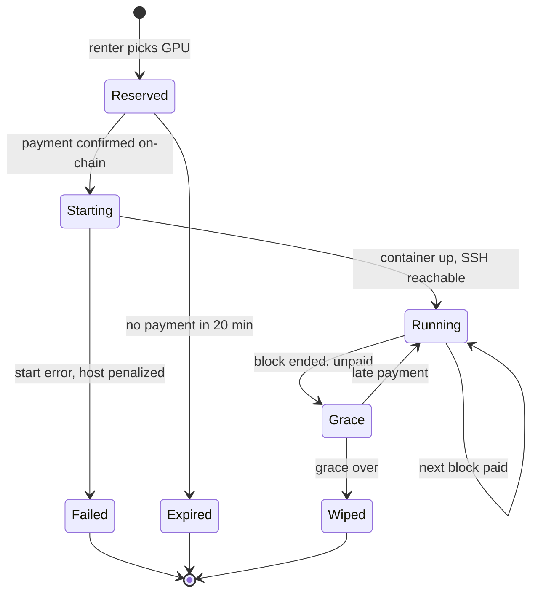
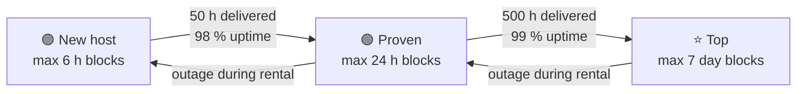
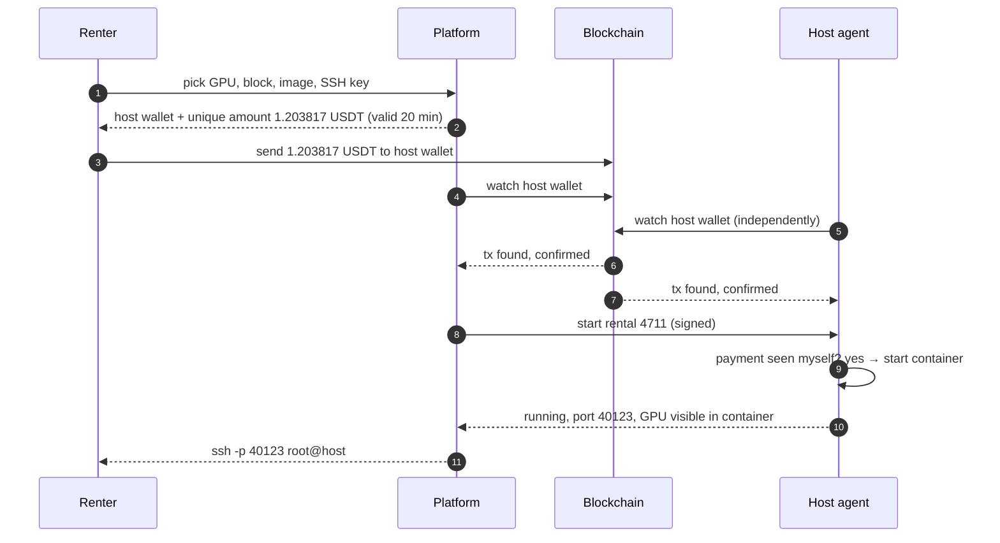
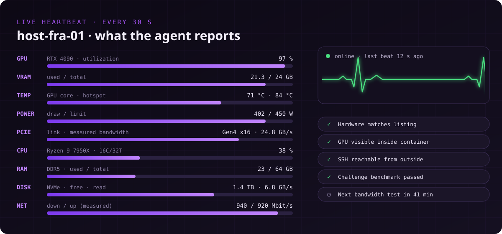
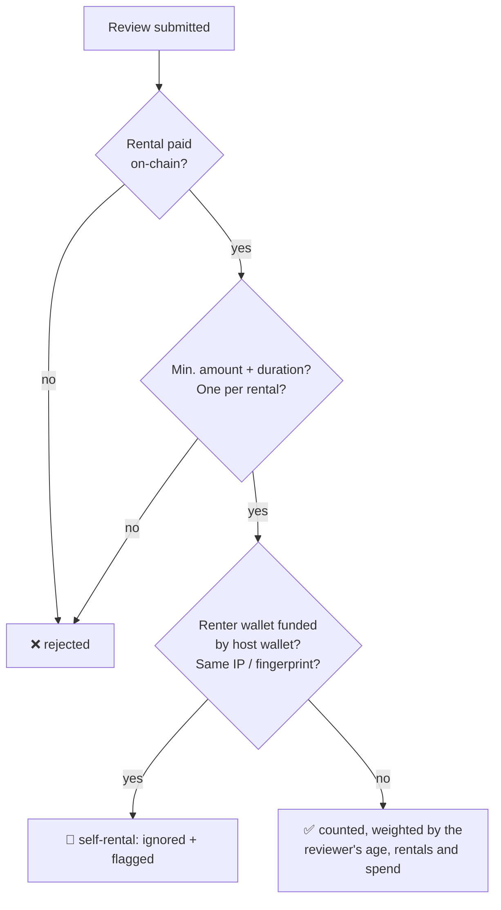
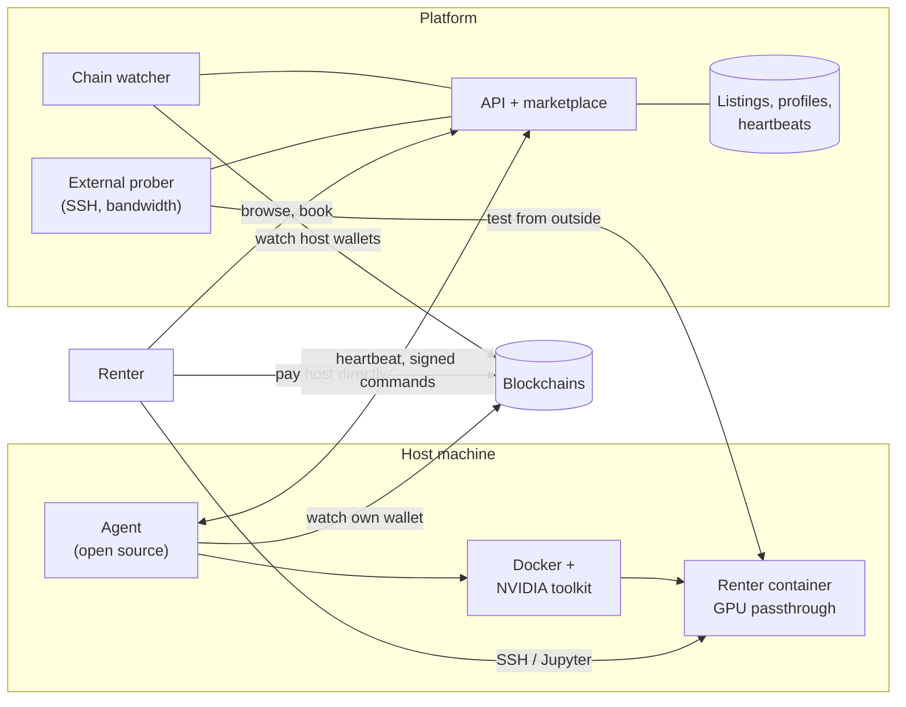

<p align="center">
  <a href="https://shadownodehosting.com/gpu"></a>
</p>

<p align="center">
  
  
  
  
</p>

<p align="center">
  <b>A peer-to-peer GPU marketplace where renters pay hosts directly in crypto.<br>The platform never holds anyone's money.</b><br><br>
  👉 <a href="https://shadownodehosting.com/gpu"><b>Join the waitlist with live demand numbers</b></a>
</p>

> **Status: concept + waitlist.** Nothing is live yet. We're measuring demand before we build it, and we'd rather hear "this breaks because…" now than after launch.

---

## Contents

- [Why](#why)
- [How a rental works](#how-a-rental-works)
- [Payments in detail](#payments-in-detail)
- [Hardware: what the agent reads, measures and watches](#hardware-what-the-agent-reads-measures-and-watches)
- [What a listing looks like](#what-a-listing-looks-like)
- [Profiles and ratings](#profiles-and-ratings)
- [Multi-account protection without ID](#multi-account-protection-without-id)
- [Security model](#security-model)
- [Architecture](#architecture)
- [Honest limitations](#honest-limitations)
- [How the platform earns](#how-the-platform-earns)
- [Roadmap](#roadmap) · [FAQ](#faq) · [Get involved](#get-involved)

---

## Why

Renting GPUs today means one of two things:

- **Big marketplaces:** card payments, KYC, and a platform that holds your balance and pays hosts out later
- **Small crypto-only sites:** you deposit coins into a balance and hope you can withdraw them again

We want a third option: **no custodial balance at all.** The renter pays the host's own wallet. The platform matches renters with hosts, verifies hardware and starts containers. That's it.

---

## How a rental works

<p align="center"></p>

| Step | What happens | Who does it |
|---|---|---|
| **1 · Pick** | Choose a GPU, block length and image (PyTorch, CUDA, Jupyter, ComfyUI, custom Docker image), then paste an SSH public key | Renter |
| **2 · Pay** | The page shows the host's wallet and a **unique amount** (e.g. `1.203817 USDT`). The extra decimals act as the order number. | Renter → host wallet |
| **3 · Verify** | The platform **and** the host agent each check the chain on their own, so not even the platform can fake a payment | Automatic |
| **4 · Start** | The agent pulls the image, starts the container with GPU passthrough, injects the SSH key and maps a port | Automatic |
| **5 · Connect** | The renter sees `ssh -p 40123 root@<host>`. For Jupyter, a tokenized URL is shown. | Renter |
| **Extend / end** | Before the block ends, the renter can pay the next one. If not, the agent stops the container and **wipes it** after a short grace period. | Renter / automatic |



### Block length grows with host reputation

Longer blocks mean more at stake if a host disappears, so the **maximum block length depends on the host's measured track record**:



Long rentals can use **auto-extend**: book a week, pay in daily installments, with a reminder before each one. Hosts can set discounts for long blocks.

---

## Payments in detail



**Why unique amounts?** Every host has one payout address. The extra decimals let both sides match a payment to exactly one rental without generating new addresses. Later, hosts can provide an **xpub** so every rental gets its own address. That's cleaner for BTC.

| Coin | Typical confirmation | Fit |
|---|---|---|
| **USDT / USDC on Solana or Tron** | seconds | ⭐ best: fast, cheap, no price risk |
| SOL | seconds | good |
| ETH (+ L2s later) | ~1 min, mainnet fees | fine for longer blocks |
| BTC | ~10 min+ | weak for short blocks, Lightning is on the wishlist |

<details>
<summary><b>Edge cases and how they're handled</b></summary>

| Case | Handling |
|---|---|
| Exchange deducts the withdrawal fee, so slightly less arrives | Small tolerance per coin. Otherwise the shortfall is counted as pro-rated time. |
| Renter pays too much | Counted as extra time, up to the host's maximum block |
| Payment after the 20 min window | Matched if the amount is still unique. Otherwise it's an orphan the host may refund (the platform can't). |
| Two rentals would get the same amount | Can't happen: amounts are reserved until expiry |
| Chain reorg | The required confirmations are set per chain, and the container only starts after them |
| Host claims "never received it" | Both the platform and the agent saw the tx, and the tx hash is public evidence on the host's profile |

</details>

---

## Hardware: what the agent reads, measures and watches

The agent is a small open-source daemon on the host (Linux, Docker + NVIDIA Container Toolkit). It collects three kinds of data.

### 1. Inventory: read once, re-checked on every start

| Component | Read | Why renters care |
|---|---|---|
| **GPU** | model, VRAM, **GPU UUID**, driver + CUDA version, power limit, compute capability | Exact card, no "4090 (trust me)" |
| **PCIe** | link generation + width **per GPU** (e.g. Gen4 x16 vs. Gen3 x4) | Riser setups at x1/x4 are much slower for training |
| **CPU** | model, cores / threads, base + boost clock, AVX-512 support | Data loading, preprocessing, compiling |
| **RAM** | total, type (DDR4/DDR5), speed, **RAM per GPU** | Large datasets, CPU offloading |
| **Disk** | type (NVMe / SATA SSD / HDD), size, **free space for renters** | Model weights and datasets need room |
| **Network** | public IP (region + ASN), open port range, IPv6 | Region, latency, reachability |
| **System** | OS, kernel, Docker + toolkit version, machine ID, board serial | Compatibility, plus [multi-account protection](#multi-account-protection-without-id) |

### 2. Benchmarks: measured, not typed in

| Benchmark | Measures | When |
|---|---|---|
| GPU compute | FP32 / FP16 / BF16 TFLOPS (matmul), tokens/s on a reference LLM | onboarding + random challenges |
| GPU memory | VRAM bandwidth (GB/s) | onboarding |
| **PCIe** | host ↔ GPU copy bandwidth (GB/s) | onboarding + after each reboot |
| **CPU** | single + multi-core score | onboarding, monthly |
| **RAM** | memory bandwidth (GB/s) | onboarding, monthly |
| **Disk** | sequential + random read/write (MB/s, IOPS) | onboarding, monthly |
| **Network** | down / up to several regions (Mbit/s), latency | every few hours, not during heavy renter traffic |

**Challenge benchmarks** are small compute jobs with a known result and a time window. They run at random times when no one is renting. A card that can't hit its listed numbers gets flagged automatically.

### 3. Live heartbeat: every 30 seconds

<p align="center"></p>

<details>
<summary><b>Example heartbeat payload</b></summary>

```json
{
  "host": "host-fra-01",
  "ts": "2026-10-27T09:41:30Z",
  "gpus": [{
    "uuid": "GPU-3f1c…",
    "model": "RTX 4090",
    "util_pct": 97, "vram_used_gb": 21.3, "vram_total_gb": 24,
    "temp_c": 71, "hotspot_c": 84, "power_w": 402, "power_limit_w": 450,
    "pcie": { "gen": 4, "width": 16 },
    "visible_in_container": true
  }],
  "cpu": { "model": "AMD Ryzen 9 7950X", "cores": 16, "threads": 32, "util_pct": 38 },
  "ram": { "type": "DDR5", "total_gb": 64, "used_gb": 23 },
  "disk": { "type": "nvme", "free_gb": 1430 },
  "net": { "rx_mbit": 112, "tx_mbit": 640 },
  "rental": { "id": 4711, "container": "running", "ssh_port": 40123 }
}
```

</details>

What the platform does with it:

- **No heartbeat for 2 minutes during a rental** → the renter is notified, an outage is logged and the host's reputation drops
- **GPU not visible inside the container** → treated as an outage, even if the host itself is up
- **SSH port tested from outside** by the platform, not self-reported by the agent
- **Thermal throttling** (high hotspot plus a clock drop) shows on the listing as a warning, since renters pay for full speed

---

## What a listing looks like

```text
┌──────────────────────────────────────────────────────────────────────┐
│  RTX 4090 · 24 GB                     ⭐ Top host · 99.7 % uptime    │
│  Frankfurt, DE · 940/920 Mbit/s · 12 ms to FRA-IX                    │
├──────────────────────────────────────────────────────────────────────┤
│  GPU    82.6 TFLOPS FP16 (measured) · PCIe Gen4 x16 · 24.8 GB/s      │
│  CPU    Ryzen 9 7950X · 16C/32T (8 threads per GPU)                  │
│  RAM    64 GB DDR5 (64 GB per GPU)                                   │
│  DISK   NVMe · 1.4 TB free · 6.8 GB/s read                           │
├──────────────────────────────────────────────────────────────────────┤
│  $0.39/h · blocks 1 h – 7 d · USDT/USDC (SOL, TRX) · SOL             │
│  1,240 h delivered · median 38 s to SSH · 4.9 ★ (61 paid reviews)    │
│  Badges: ✓ Hardware verified  ✓ Fast start  ✓ 1,000 h               │
└──────────────────────────────────────────────────────────────────────┘
```

Renters can filter by GPU, VRAM, **CPU cores per GPU, RAM per GPU, PCIe width, disk free**, bandwidth, region, price, coin and reliability.

---

## Profiles and ratings

Every host and every renter has a public profile. **Measured data counts more than opinions.**

### Host profile

| Part | Contents | Weight |
|---|---|---|
| **Measured score** | delivered rental hours, uptime during rentals, benchmark accuracy (listed vs. measured), median time from payment to SSH, failed starts, thermal throttling | ~70 % |
| **Renter reviews** | stars + short text, **only for rentals paid on-chain**, one per rental, with a minimum amount and duration | ~30 % |
| **Badges** | Hardware verified · 99.9 % uptime · 1,000 h delivered · Fast start (< 60 s) · Long-term (7-day blocks) | display only |
| **History** | uptime, price and benchmark graphs over time, public payment tx hashes of completed rentals | display only |

### Renter profile

- paid rentals, total hours, on-time extensions
- host feedback (only verifiable things: abuse reports, rule violations)
- hosts can set minimums for expensive hardware, e.g. "only renters with 10+ paid rentals"

### Why the ratings are hard to fake



- No review without a real, paid rental, so every fake review costs real money
- New reviewer accounts carry little weight
- The **measured score (~70 %) can't be influenced by reviews at all**

---

## Multi-account protection without ID

| Abuse | Countermeasure |
|---|---|
| Free first GPU on every new account | "Free" is tied to the **GPU UUID**, not the account. Each physical card is free once, ever. |
| New account to escape a bad reputation | A **hardware fingerprint** (GPU UUIDs + board serial + machine ID) carries reputation and bans to any new account. |
| Fresh accounts in general | Every new account starts at zero: short blocks only and low in search, so starting over costs income |
| Many accounts behind one host | Accounts are linked by a shared payout wallet, a shared fee-paying wallet or the same public IP / ASN range |
| Pumping reputation via self-rental | The score is mostly measured uptime. Chain analysis flags renter wallets funded by the host. |
| Bot sign-ups | Proof-of-work on sign-up, rate limits, and listing requires a running agent with real hardware |

No system without ID is perfect. But the free tier is worth a few dollars a month, and gaming it costs more effort than it pays.

---

## Security model

| Threat | Mitigation |
|---|---|
| Renter attacks the host machine | Containers run unprivileged with only the rented GPUs passed through, no host network, separate storage and a resource cap on CPU/RAM per rental |
| Renter attacks other renters | Network isolation between rentals, separate volumes, everything wiped on expiry |
| Renter abuses the host's IP (attacks, spam) | Egress rate limits and blocked SMTP by default. Abuse reports lead to the renter's ban, and the host can choose stricter egress. |
| Host snoops on the renter | Can't be prevented on hardware you don't own (true on every cloud). We say this clearly, and confidential-computing GPUs are on the long-term wishlist. |
| Host fakes hardware | Inventory checks, challenge benchmarks and outside measurements |
| Platform fakes payments | The agent verifies payments on-chain itself before starting anything |
| Compromised platform | It holds **no funds**. Agent commands are signed, and the agent only starts containers for payments it has seen. |

---

## Architecture



---

## Honest limitations

- **The host can technically inspect what runs on their machine.** That's true for every rented GPU, including big clouds. Don't put secrets on hardware you don't own.
- **A host with root can tamper with the agent.** Challenge benchmarks and outside measurements make cheating expensive and visible, but not impossible. The same is true on every marketplace.
- **No refunds by the platform.** It never holds funds. Short blocks and reputation are the protection, not chargebacks.
- **Exact amounts matter.** Pay from your own wallet, not straight from an exchange.
- **Hosts handle their own taxes and local rules.** The platform doesn't pay anyone out, so it doesn't issue statements either.

---

## How the platform earns

Not from rentals: those go straight from renter to host, with **0 % commission**.

- **First GPU: free to list**, forever (tied to the card)
- **From the second GPU on:** a small monthly listing fee per GPU, paid by the host in crypto
- **Possibly later:** optional paid extras for hosts (featured listing, custom subdomain). Never anything that affects the ratings.

---

## Roadmap

- [x] Waitlist with live, aggregated demand (GPU model, region, price, coins)
- [x] Concept: payments, verification, ratings, multi-account protection (this document)
- [ ] Host agent prototype: inventory (GPU, CPU, RAM, disk, PCIe), heartbeat, benchmarks
- [ ] Chain watcher: unique amounts, USDT/USDC on Solana + Tron first
- [ ] Auto start: image pull, SSH key injection, port mapping, wipe on expiry
- [ ] External prober: SSH reachability, bandwidth
- [ ] Profiles: measured score, on-chain-verified reviews, badges
- [ ] Marketplace UI with filters (GPU, VRAM, CPU/RAM per GPU, PCIe, region, price)
- [ ] Closed beta with waitlist hosts
- [ ] Public launch

We only move past the agent prototype if enough hosts **and** renters sign up in the same regions.

---

## FAQ

<details><summary><b>Do I need to upload an ID?</b></summary>

No. Reputation comes from measured data and paid rentals, not documents. The rules still apply: no CSAM, no attacks or botnets, no cracking other people's keys, no malware.
</details>

<details><summary><b>Which GPUs can be listed?</b></summary>

NVIDIA cards with enough VRAM for real workloads, starting with the RTX 30/40/50 series and datacenter cards. AMD (ROCm) is on the wishlist.
</details>

<details><summary><b>Can I mine on a rented GPU?</b></summary>

Only on listings where the host allows it. Hosts decide per listing.
</details>

<details><summary><b>What happens to my data when the rental ends?</b></summary>

The container and its volume are deleted after the grace period. Download your results before the block ends.
</details>

<details><summary><b>What if the host goes offline mid-rental?</b></summary>

You're notified at once, the outage is logged publicly on the host's profile, and the host drops a tier. You lose at most the current block. That's why new hosts can only offer short blocks.
</details>

<details><summary><b>Is the agent open source?</b></summary>

Yes, that's the plan. Hosts should be able to read exactly what runs on their machine.
</details>

---

## Get involved

- **Hosts:** tell us which GPUs you have, where, and what you'd charge
- **Renters:** tell us what you need (GPU, VRAM, CPU/RAM, hours) and what you'd pay
- **Feedback:** open an issue or a discussion. Especially welcome: agent security, payment matching, rating abuse and multi-account ideas

<p align="center"><a href="https://shadownodehosting.com/gpu"><b>👉 shadownodehosting.com/gpu</b></a></p>
